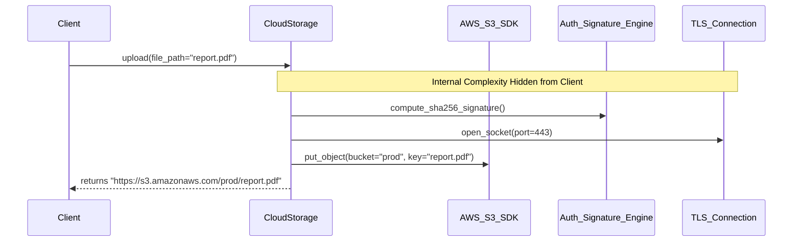

# Abstraction

> [!TIP]
> **Interactive Diagram**: Open [diagram.html](diagram.html) in your browser to explore the interactive animated data flow with theme toggles and SVG/image export.

## Overview
- **Abstraction**: The process of hiding internal, low-level implementation details and exposing only essential features to the outside world.
- **Abstraction vs. Encapsulation**:
  - *Abstraction* answers **"What does it do?"** (Focuses on the outside interface).
  - *Encapsulation* answers **"How is it protected?"** (Hiding data/state within boundaries).

## Architecture & Data Flow

## FAANG Interview Significance
- Simplifies mental models for clients of a library, framework, or microservice.
- Essential for designing clean SDKs, database drivers, and clean API routes.
