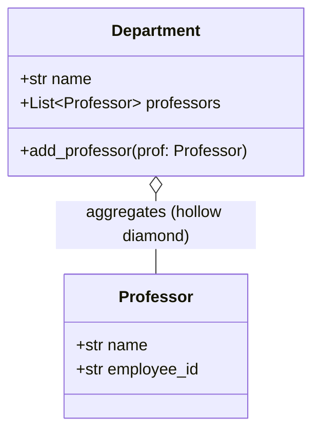

# Aggregation

> [!TIP]
> **Interactive Diagram**: Open [diagram.html](diagram.html) in your browser to explore the interactive animated data flow with theme toggles and SVG/image export.

## Overview
- **Aggregation**: A specialized form of association that represents a **"has-a"** relationship with **weak ownership**.
- **Key Characteristics**:
  - **Whole-Part Relationship**: The container represents the "whole", and the contained objects are "parts".
  - **Weak Ownership / Independent Lifecycle**: If the container is destroyed, the contained objects **continue to exist**.
  - **UML Notation**: Hollow diamond (`o--`) pointing toward the container.

## Architecture & Data Flow

## FAANG Interview Significance
- Crucial distinction in system modeling (e.g., University & Professors, Team & Players, Playlist & Songs).
- Knowing whether deleting an entity cascades down to child entities or preserves them (e.g., deleting a Playlist does NOT delete the Songs from the music library).
