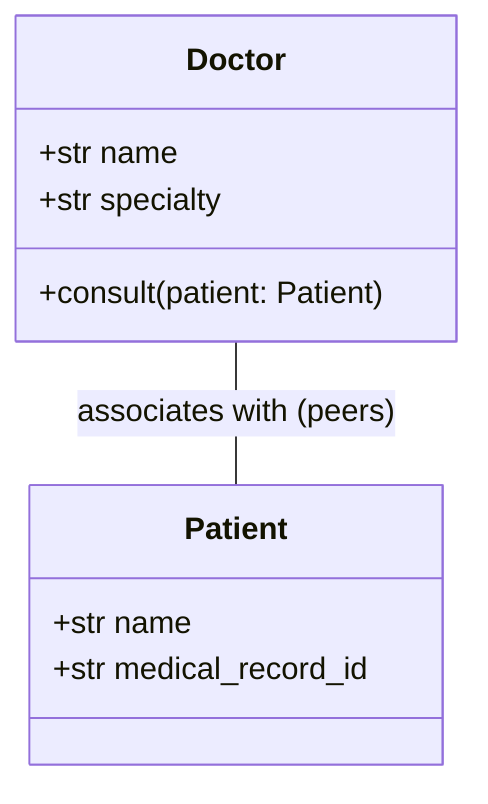

# Association

> [!TIP]
> **Interactive Diagram**: Open [diagram.html](diagram.html) in your browser to explore the interactive animated data flow with theme toggles and SVG/image export.

## Overview
- **Association**: A structural relationship between two independent classes where objects communicate or interact with each other ("uses-a" relationship).
- **Key Characteristics**:
  - **No ownership**: Neither object owns the other.
  - **Independent lifecycles**: If one object is destroyed, the other continues to exist unaffected.
  - Can be unidirectional or bidirectional; 1-to-1, 1-to-many, or many-to-many.

## Architecture & Data Flow

## FAANG Interview Significance
- Foundation for modeling business domain entities (e.g., Driver & Passenger in Uber/Lyft LLD; Buyer & Seller in Amazon LLD).
- Used to keep classes decoupled when neither is a parent or sub-component of the other.
