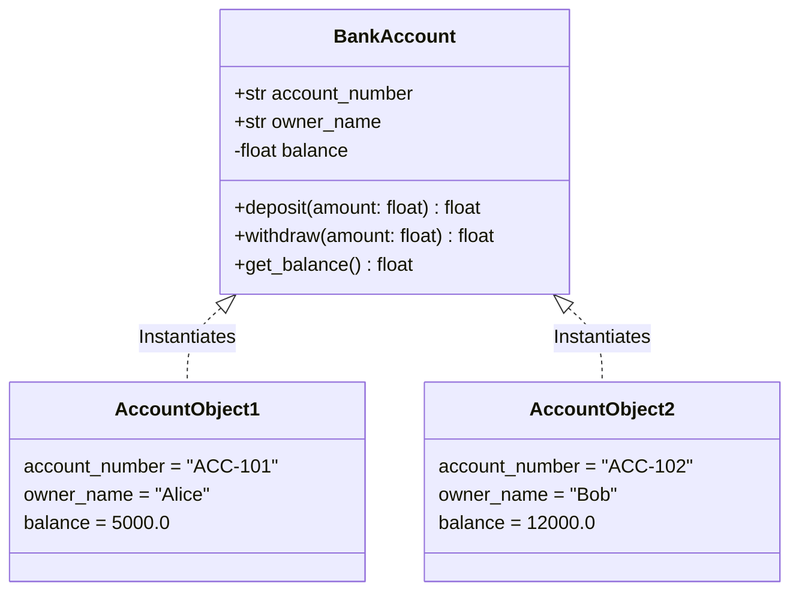

# Classes and Objects

> [!TIP]
> **Interactive Diagram**: Open [diagram.html](diagram.html) in your browser to explore the interactive animated data flow with theme toggles and SVG/image export.


## Overview
- **Class**: A blueprint, template, or prototype defining the state (attributes) and behavior (methods) common to all objects of that type.
- **Object**: A concrete instance of a class allocated in memory with its own independent state.

## Architecture & Data Flow



### ASCII Diagram
```
   +-----------------------------+
   |      Class: BankAccount     |  <-- Blueprint (Code in memory)
   +-----------------------------+
   | - account_number: str       |
   | - owner_name: str           |
   | - balance: float            |
   | + deposit(amount)           |
   | + withdraw(amount)          |
   +-----------------------------+
               /        \
              /          \  Instantiation (__init__)
             v            v
+--------------------+   +--------------------+
|  Object: Alice     |   |  Object: Bob       |
|  ACC-101, $5,000   |   |  ACC-102, $12,000  |
+--------------------+   +--------------------+
```

## FAANG Interview Significance
- **Memory & Lifecycle**: Understanding class attributes (`cls.var`) vs instance attributes (`self.var`).
- **Constructors**: Python's `__new__` (allocator) vs `__init__` (initializer).
- **Clean Models**: In FastAPI (Pydantic models) vs Django (ORM models), classes model both persistence entities and domain entities.
