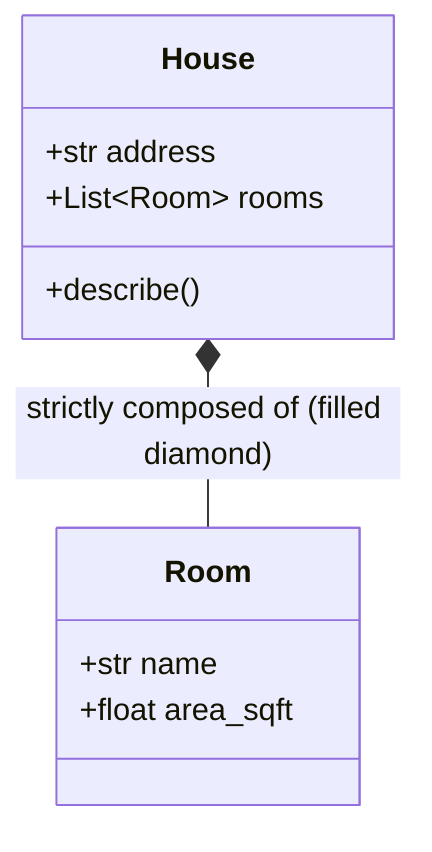

# Composition

> [!TIP]
> **Interactive Diagram**: Open [diagram.html](diagram.html) in your browser to explore the interactive animated data flow with theme toggles and SVG/image export.

## Overview
- **Composition**: A specialized form of association that represents a **"part-of"** relationship with **strong ownership**.
- **Key Characteristics**:
  - **Co-dependent Lifecycle**: The lifetime of the parts is strictly bound to the lifetime of the whole.
  - **Creation within Whole**: The container is responsible for instantiating its parts. If the whole is destroyed, the parts are **destroyed** with it.
  - **UML Notation**: Filled diamond (`*--`) pointing toward the container.

## Architecture & Data Flow

## Comparison Matrix: Association vs Aggregation vs Composition

| Feature | Association | Aggregation | Composition |
| :--- | :--- | :--- | :--- |
| **Relationship** | "Uses-a" / Peer-to-peer | "Has-a" (Weak ownership) | "Part-of" (Strong ownership) |
| **Lifecycle** | Completely independent | Independent (Child outlives Parent) | Co-dependent (Child dies with Parent) |
| **UML Symbol** | Solid line (`--`) | Hollow diamond (`o--`) | Filled diamond (`*--`) |
| **Real-world Example** | Doctor & Patient | Department & Professor | House & Rooms, Order & OrderLines |

## FAANG Interview Significance
- Essential for database cascade deletes (`ON DELETE CASCADE` in SQL/Django ORM).
- "Favor composition over inheritance" is the #1 design rule in clean software engineering.
