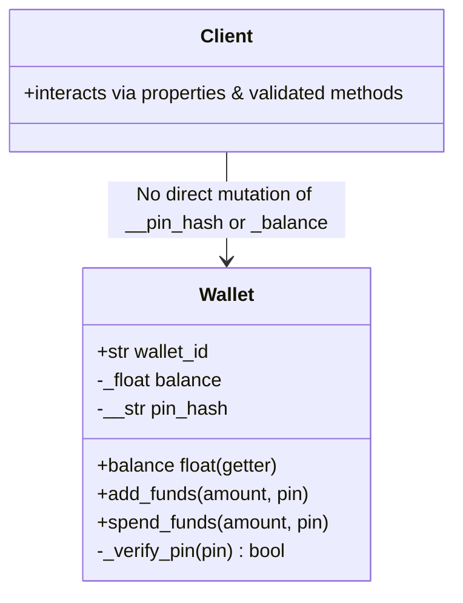

# Encapsulation

> [!TIP]
> **Interactive Diagram**: Open [diagram.html](diagram.html) in your browser to explore the interactive animated data flow with theme toggles and SVG/image export.

## Overview
- **Encapsulation**: Bundling of data (attributes) and the methods that operate on that data into a single unit, and restricting direct external modification to maintain class invariants.
- **Python Convention**:
  - `public`: Accessible anywhere (`self.title`).
  - `_protected`: Convention indicating internal use (`self._cached_value`).
  - `__private`: Name mangling to prevent accidental override (`self.__ssn` becomes `_ClassName__ssn`).
  - `@property`: Clean getters, setters, and validation decorators without breaking API compatibility.

## Architecture & Data Flow

## FAANG Interview Significance
- Ensures objects cannot enter an illegal or corrupt state (e.g., negative bank balance, invalid email address).
- In frameworks like FastAPI and Pydantic, getters/setters and root validators act as the encapsulation boundaries.
