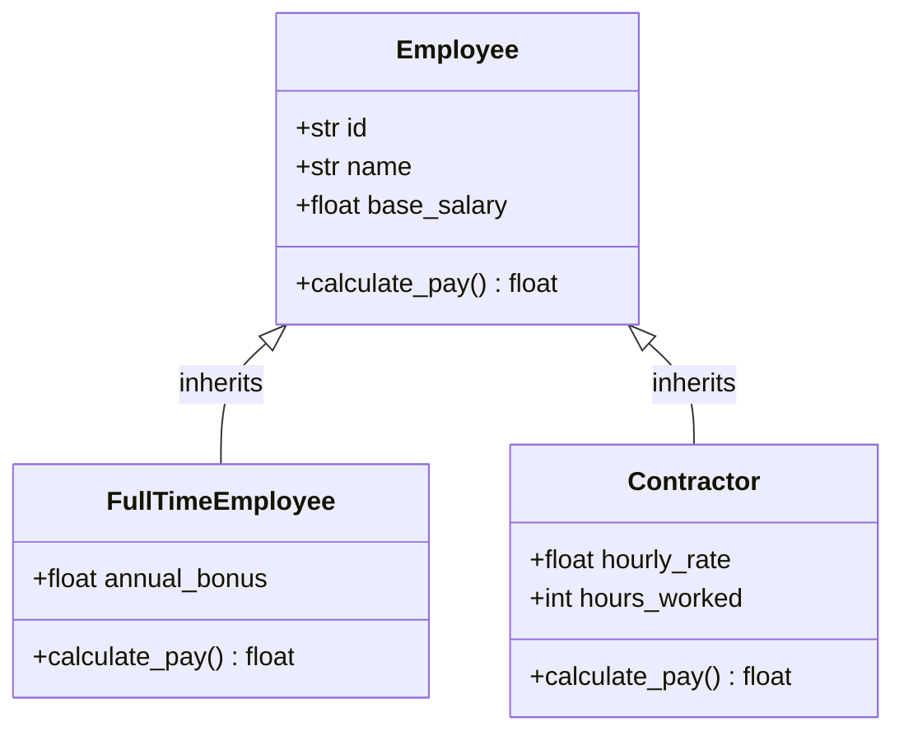

# Inheritance & Method Resolution Order (MRO)

> [!TIP]
> **Interactive Diagram**: Open [diagram.html](diagram.html) in your browser to explore the interactive animated data flow with theme toggles and SVG/image export.


## Overview
- **Inheritance**: Mechanism where a child class derives attributes and methods from a parent class ("is-a" relationship).
- **Multiple Inheritance & MRO**: Python supports inheriting from multiple parents using the **C3 Linearization Algorithm** to resolve method resolution order without ambiguities (solves the Diamond Problem).

## Architecture & Data Flow



## The Diamond Problem & C3 Linearization

```
       [BaseService]
       /           \
[AuditMixin]    [MetricsMixin]
       \           /
      [PaymentService]
```
MRO order: `PaymentService -> AuditMixin -> MetricsMixin -> BaseService -> object`.

## FAANG Interview Significance
- **Composition over Inheritance**: Favor composition when sharing behavior across unrelated types to prevent deep, rigid inheritance hierarchies.
- **Mixins**: Small, reusable classes that provide specific functionality (e.g. `LoggingMixin`, `AuditMixin`) common in Django and Flask.
