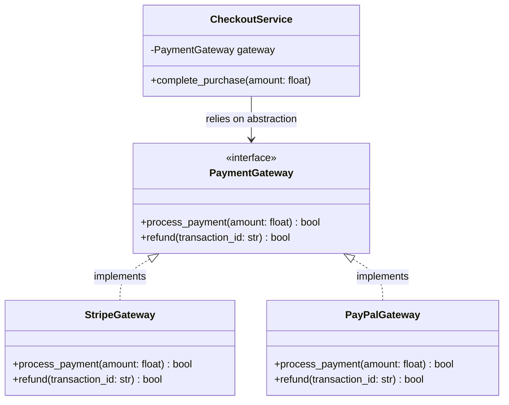

# Interfaces and Protocols

> [!TIP]
> **Interactive Diagram**: Open [diagram.html](diagram.html) in your browser to explore the interactive animated data flow with theme toggles and SVG/image export.

## Overview
- **Interface (`abc.ABC`)**: A contract specifying methods that concrete classes MUST implement (Nominal subtyping: explicit inheritance required).
- **Protocol (`typing.Protocol`)**: Structural subtyping (Static Duck Typing introduced in PEP 544). If an object has the required methods and signature, it satisfies the protocol without explicit subclassing.

## Architecture & Data Flow

## FAANG Interview Significance
- **Dependency Inversion Principle (DIP)**: Depend on abstractions, not concretions.
- **Testing & Mocking**: Interfaces allow swapping actual third-party payment providers with mock implementations in unit tests.
- **FastAPI/Flask Dependency Injection**: Interface protocols are the standard way to declare dependencies (e.g. `gateway: PaymentGateway = Depends(...)`).
