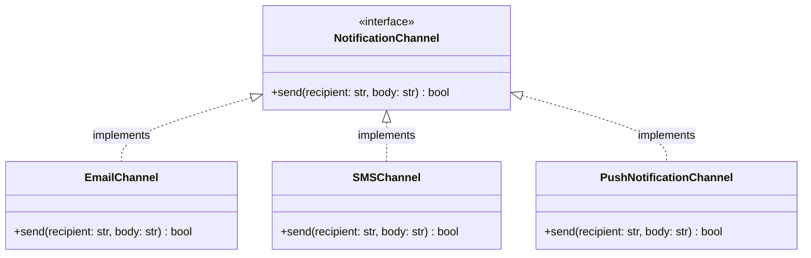

# Polymorphism

> [!TIP]
> **Interactive Diagram**: Open [diagram.html](diagram.html) in your browser to explore the interactive animated data flow with theme toggles and SVG/image export.


## Overview
- **Polymorphism ("Many Forms")**: The ability of different classes to respond to the same method call with their own specific behavior.
- **Dynamic Polymorphism (Runtime)**: Method overriding via inheritance or duck typing where the executed method is determined at runtime based on the object instance.
- **Static Polymorphism (Compile/Dispatch-time)**: Method overloading in Python accomplished via `@functools.singledispatch` or optional/default parameters.

## Architecture & Data Flow



### Flow
```
Client -> [NotificationChannel.send()]
              |
              +--> EmailChannel ("Connecting to SMTP...")
              +--> SMSChannel ("Calling Twilio API...")
              +--> PushChannel ("Dispatching FCM token...")
```

## FAANG Interview Significance
- Eliminates messy `if/elif/else` or `switch` chains (violating Open/Closed principle).
- Enables the **Strategy Pattern** and plugin-based architectures.
