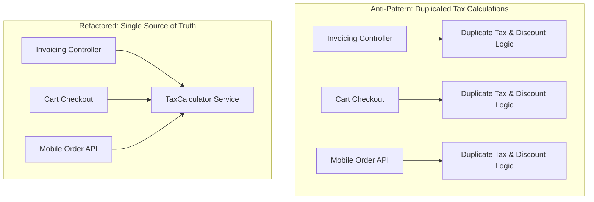

# Don't Repeat Yourself (DRY)

> [!TIP]
> **Interactive Diagram**: Open [diagram.html](diagram.html) in your browser to explore the interactive animated data flow with theme toggles and SVG/image export.

## Overview
- **DRY Principle**: "Every piece of knowledge must have a single, unambiguous, authoritative representation within a system."
- **WET Code (Anti-Pattern)**: "We Enjoy Typing" or "Write Everything Twice" — duplicating business logic, validation rules, or database queries across multiple controllers/services.
- **The Balance**: Avoid "Accidental Duplication" (code that looks similar today but represents different domain concepts and will diverge tomorrow).

## Architecture & Data Flow

## FAANG Interview Significance
- Bugs occur when tax/discount/auth rules change in one place but developers forget to update the 3 other duplicate places.
- In FastAPI/Flask/Django: Encapsulating validation in Pydantic validators, Django custom model managers, or shared service layers.
