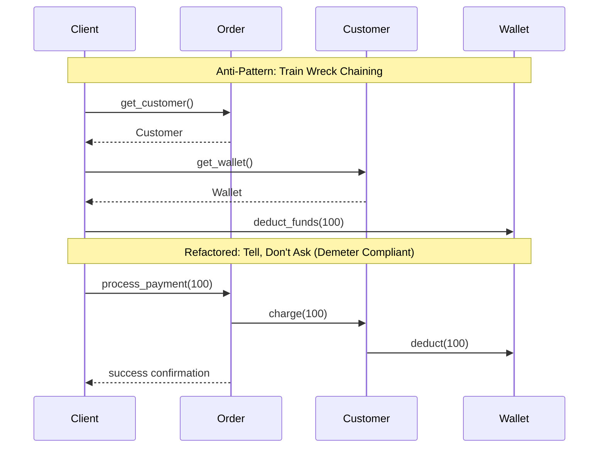

# Law of Demeter (LoD) / Principle of Least Knowledge

> [!TIP]
> **Interactive Diagram**: Open [diagram.html](diagram.html) in your browser to explore the interactive animated data flow with theme toggles and SVG/image export.

## Overview
- **Law of Demeter (LoD)**: Each unit should have only limited knowledge about other units: only units "closely" related to the current unit.
- **Rule of Thumb**: "Talk only to your immediate friends; don't talk to strangers."
- **Train Wreck (Anti-Pattern)**: Deep chaining like `order.get_customer().get_profile().get_address().get_zip_code()`. If any intermediate object changes or returns `None`, the whole chain breaks.

## Architecture & Data Flow

## Demeter Guidelines (Methods a function may call):
An object `M` of class `C` may only invoke methods of:
1. `C` itself.
2. An object created by `M`.
3. Any arguments passed to `M`.
4. Any object held in an instance variable of `C`.

## FAANG Interview Significance
- Enforces loose coupling and prevents fragile unit tests where every mock needs 5 layers of child mocks.
- "Tell, Don't Ask" mindset in domain-driven design.
