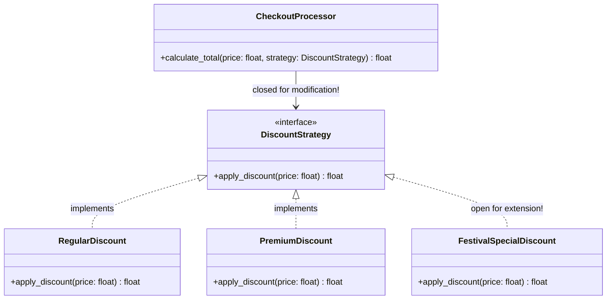

# Open/Closed Principle (OCP)

> [!TIP]
> **Interactive Diagram**: Open [diagram.html](diagram.html) in your browser to explore the interactive animated data flow with theme toggles and SVG/image export.

## Overview
- **Definition**: "Software entities (classes, modules, functions) should be **open for extension**, but **closed for modification**."
- **The Problem**: If adding a new payment method or discount rule forces you to modify, re-test, and risk breaking an existing 200-line `if/elif/else` function, you are violating OCP.
- **The Solution**: Depend on abstractions (interfaces, base classes). Add new features by adding new classes, not modifying existing ones.

## Architecture & Data Flow

## FAANG Interview Significance
- Essential for payment gateways, tax calculation engines, notification systems, and plugin architectures.
- Eliminates regression bugs when requirements scale.
