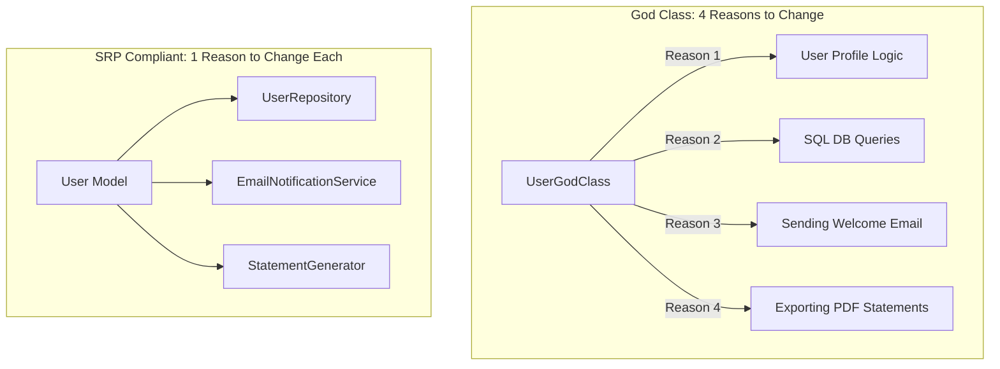

# Single Responsibility Principle (SRP)

> [!TIP]
> **Interactive Diagram**: Open [diagram.html](diagram.html) in your browser to explore the interactive animated data flow with theme toggles and SVG/image export.

## Overview
- **Definition**: "A class should have one, and only one, reason to change."
- **God Class (Anti-Pattern)**: A single class that mixes business logic, database persistence, email notification, and report generation.
- **Signs of SRP Violation**:
  - Too many imports from completely different domains (e.g., `smtplib`, `sqlite3`, `reportlab`).
  - Merge conflicts where multiple developers edit the same file for different reasons.

## Architecture & Data Flow

## FAANG Interview Significance
- The foundation of 3-tier / Clean Architecture in FastAPI, Flask, and Django.
- Enables parallel development and isolated unit testing.
