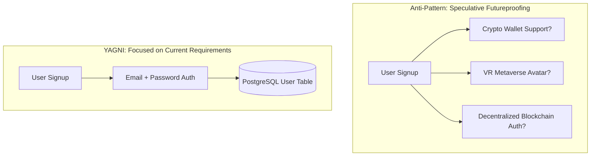

# You Aren't Gonna Need It (YAGNI)

> [!TIP]
> **Interactive Diagram**: Open [diagram.html](diagram.html) in your browser to explore the interactive animated data flow with theme toggles and SVG/image export.

## Overview
- **YAGNI Principle**: A core Extreme Programming (XP) principle stating that a programmer should not add functionality until deemed strictly necessary.
- **Speculative Generalization (Anti-Pattern)**: Writing complex code, hooks, and database schemas today for features you "might" need 2 years from now (e.g. building multi-currency cryptocurrency conversion and 3D avatar rendering when the app just needs basic user email registration).

## Architecture & Data Flow

## FAANG Interview Significance
- Demonstrates pragmatic product engineering vs academic speculation.
- In system design & LLD interviews: Stick to the functional requirements given by the interviewer before adding premature features.
