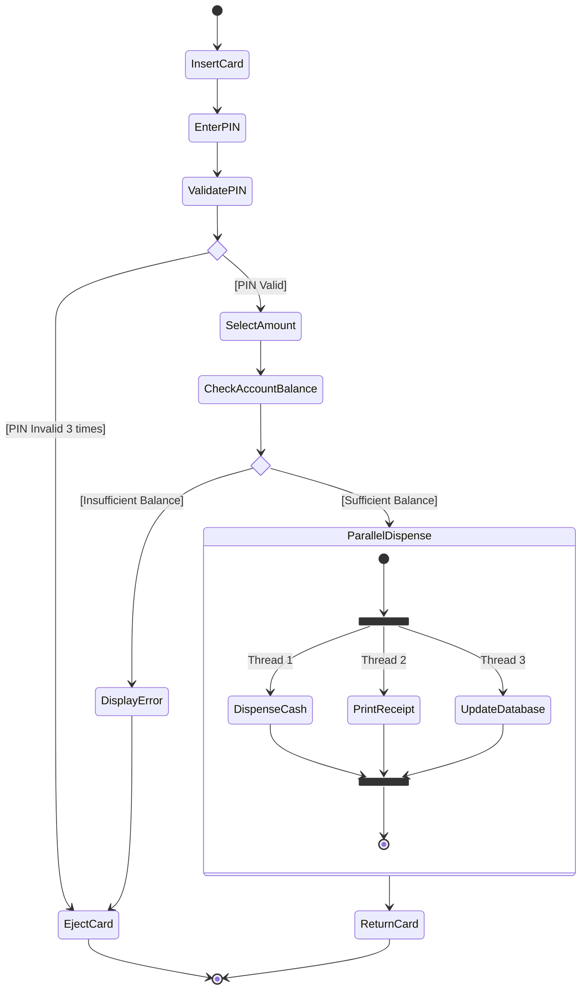

# UML Activity Diagram

## Overview
An **Activity Diagram** describes the workflow of a system, modeling control flow, logic branching, and concurrent operations:
- **Initial State (Filled Circle)**: Workflow entry point.
- **Action State (Rounded Rectangle)**: An execution step (e.g. "Validate Card").
- **Decision Node (Diamond)**: Conditional branching with guards (`[balance >= amount]`).
- **Fork Bar**: Splits a single flow into multiple concurrent parallel threads.
- **Join Bar**: Synchronizes concurrent flows before proceeding.
- **Final State (Bullseye / Bordered Circle)**: Workflow completion.

## Architecture & Data Flow: ATM Withdrawal Workflow

## FAANG LLD Interview Tips
- Great for illustrating concurrency and background jobs (e.g., when an order is placed, simultaneously charge card, update search index, and dispatch Kafka event via fork/join).
