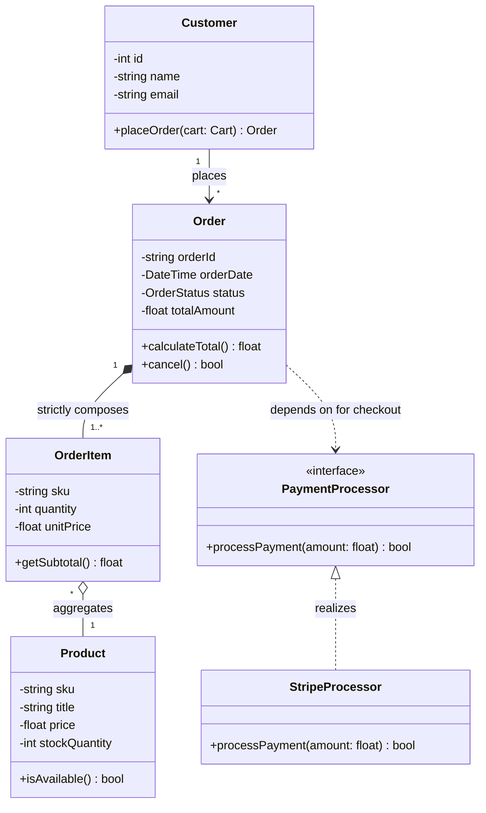

# UML Class Diagram

## Overview
A **Class Diagram** is a static structural diagram that describes the structure of a system by showing the system's classes, their attributes, operations (or methods), and the relationships among objects.

## Key Notations & Relationships

| Relationship | Symbol | Mermaid Syntax | Meaning |
| :--- | :--- | :--- | :--- |
| **Inheritance (Is-A)** | Solid line with hollow triangle | `<\|--` | Subclass derives from Superclass |
| **Realization / Implements** | Dashed line with hollow triangle | `<\|..` | Class implements an Interface |
| **Association (Uses-A)** | Solid line | `--` or `-->` | Peer-to-peer relationship |
| **Aggregation (Has-A, Weak)** | Solid line with hollow diamond | `o--` | Part can exist independently of whole |
| **Composition (Part-Of, Strong)** | Solid line with filled diamond | `*--` | Part lifecycle tied to whole |
| **Dependency** | Dashed line with open arrow | `..>` | Class depends on another temporarily |

## Full Example: E-Commerce System Class Diagram

## FAANG LLD Interview Tips
- When asked to sketch a class diagram:
  1. Draw core entity boxes (e.g., `Vehicle`, `ParkingSpot`, `Ticket`).
  2. Put attributes in the middle compartment and primary methods in the lower compartment.
  3. Mark cardinalities clearly (`1`, `*`, `0..1`).
  4. Use Composition (`*--`) for internal objects that cannot survive parent deletion.
