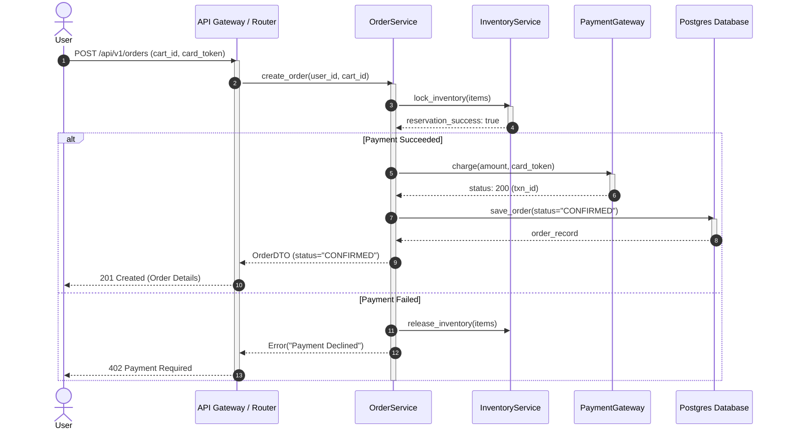

# UML Sequence Diagram

## Overview
A **Sequence Diagram** is an interaction diagram that details how operations are carried out over time. It captures:
- **Lifelines**: Objects/actors participating in the interaction over a vertical timeline.
- **Activation Boxes**: Periods during which an object is executing an operation.
- **Synchronous Calls (`->>`)**: Caller waits for the callee to return.
- **Asynchronous Calls (`-x`)**: Fire-and-forget message passing.
- **Return Messages (`-->>`)**: Value or control returned to the caller.
- **Frames**: `alt` (conditional branching), `loop` (iterations), and `opt` (optional steps).

## Architecture & Data Flow: Order Checkout Flow

## FAANG LLD Interview Tips
- The sequence diagram is the most requested diagram when explaining the runtime data flow in machine coding rounds.
- Focus on happy path first, then show error/rollback flows in `alt` blocks.
