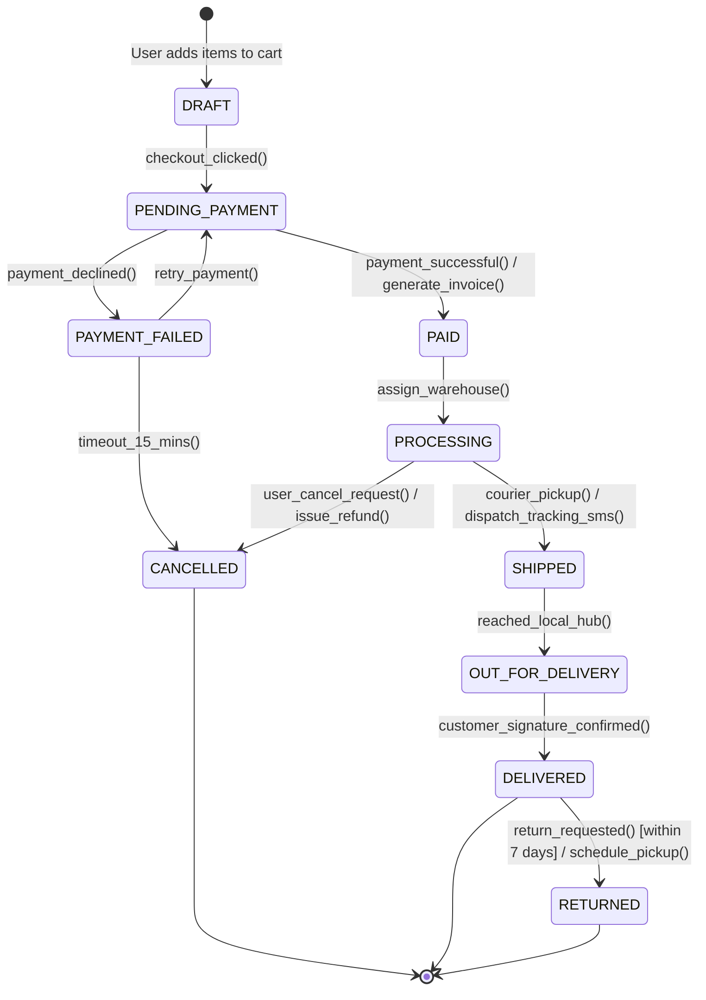

# UML State Machine Diagram

## Overview
A **State Machine Diagram** (or Statechart) models the lifecycle of an object as it transitions through various states in response to internal or external events.
- **State**: Condition or situation in the life of an object during which it satisfies some condition or performs an activity.
- **Transition**: Relationship between two states triggered by an event.
- **Guard Condition `[condition]`**: Boolean expression that must be true for the transition to fire.
- **Action `/ action()`**: Operation executed during state transition.

## Architecture & Data Flow: Order State Machine

## Direct Connection to Design Patterns
- State Machine Diagrams directly translate into the **State Design Pattern** in code.
- Rather than messy nested `if order.status == "PENDING": elif order.status == "PAID": ...`, each state becomes a dedicated class encapsulating valid state transitions.
