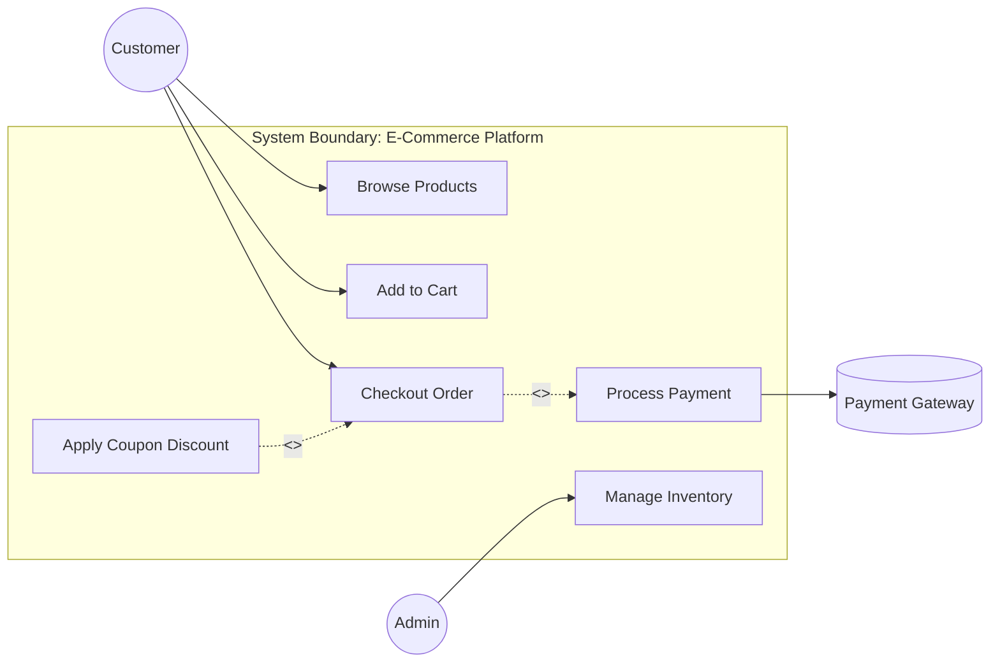

# UML Use Case Diagram

## Overview
A **Use Case Diagram** captures the dynamic behavior of a system from an external actor's perspective. It outlines:
- **Actors**: Users, roles, or external systems interacting with the application.
- **Use Cases**: Specific functional goals achieved by interacting with the system.
- **System Boundary**: The scope defining what is inside vs outside the application.
- **Relationships**:
  - `<<include>>`: Mandatory sub-routine (e.g., Checkout **includes** Authenticate User).
  - `<<extend>>`: Optional or conditional sub-routine (e.g., Apply Promo Code **extends** Checkout).

## Architecture Diagram (Mermaid)



### ASCII Representation
```
 (Customer)
     |
     +-----> [ Browse Catalog ]
     |
     +-----> [ Checkout Order ]
                   |
                   +-- <<include>> --> [ Process Payment ] ---> (Stripe Gateway)
                   ^
                   |-- <<extend>> ---- [ Apply Promo Coupon ]
```

## FAANG LLD Interview Tips
- Use this in the first 5 minutes of an LLD interview to confirm the exact scope with your interviewer.
- Example: *"For the Parking Lot system, are we modeling just the Driver paying at the kiosk, or also the Parking Attendant and Admin generating daily reports?"*
