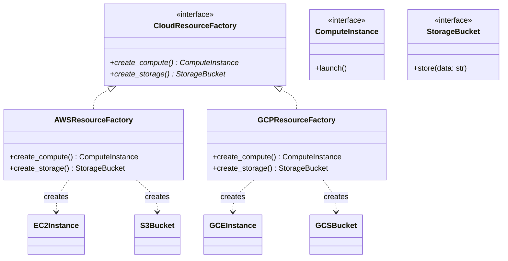

# Abstract Factory Pattern

> [!TIP]
> **Interactive Diagram**: Open [diagram.html](diagram.html) in your browser to explore the interactive animated data flow with theme toggles and SVG/image export.

## Overview
- **Intent**: Provide an interface for creating **families of related or dependent objects** without specifying their concrete classes.
- **Difference from Factory Method**:
  - *Factory Method* creates **one product** using inheritance.
  - *Abstract Factory* creates a **family of related products** using object composition.

## Architecture & Data Flow

## FAANG Interview Significance
- Typical interview questions: Cross-platform UI toolkit (Mac vs Windows Buttons, Checkboxes, Dialogs), Multi-cloud infrastructure provisioners (AWS vs GCP vs Azure), Database connectors (SQL vs NoSQL query generators).
