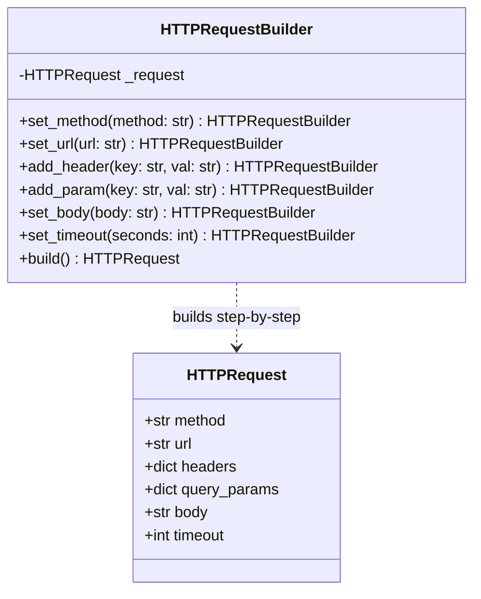

# Builder Pattern

> [!TIP]
> **Interactive Diagram**: Open [diagram.html](diagram.html) in your browser to explore the interactive animated data flow with theme toggles and SVG/image export.

## Overview
- **Intent**: Separate the construction of a complex object from its representation so that the same construction process can create different representations.
- **Classification**: Creational Pattern.
- **Problem It Solves**: Eliminates "Telescoping Constructor Anti-Pattern" (where a class constructor takes 10+ arguments, many of which are optional `None`s).
- **Key Characteristics**:
  - Step-by-step construction.
  - Method chaining (fluent interface: `builder.set_a().set_b().build()`).
  - Immutability of the resulting product once built.

## Architecture & Data Flow

## FAANG Interview Significance
- Extremely common when designing APIs, SQL Query Builders (e.g. SQLAlchemy, Django ORM QuerySet chaining), or complex payloads (Elasticsearch query DSL).
