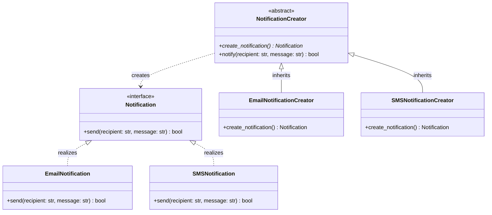

# Factory Method Pattern

> [!TIP]
> **Interactive Diagram**: Open [diagram.html](diagram.html) in your browser to explore the interactive animated data flow with theme toggles and SVG/image export.

## Overview
- **Intent**: Define an interface for creating an object, but let subclasses decide which class to instantiate. Factory Method lets a class defer instantiation to subclasses.
- **Classification**: Creational Pattern.
- **Problem It Solves**: Eliminates tight coupling between client code and concrete product classes. Adding new product types does not modify existing creator code (Open/Closed Principle).

## Architecture & Data Flow

## FAANG Interview Significance
- One of the top 3 most frequently asked patterns in LLD rounds.
- Applied in logistics (Truck vs Ship transport), payment systems (CreditCard vs UPI processor), and document parsers (PDF vs CSV reader).
