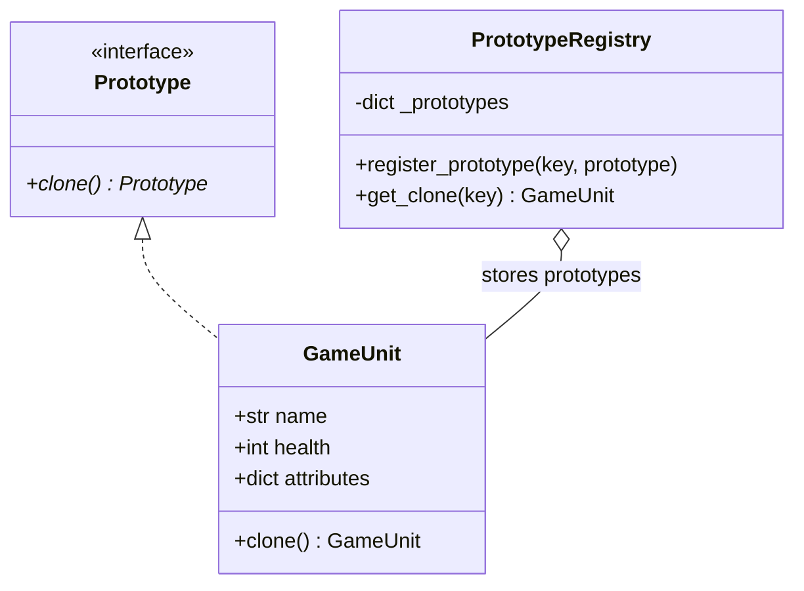

# Prototype Pattern

> [!TIP]
> **Interactive Diagram**: Open [diagram.html](diagram.html) in your browser to explore the interactive animated data flow with theme toggles and SVG/image export.

## Overview
- **Intent**: Specify the kinds of objects to create using a prototypical instance, and create new objects by copying/cloning this prototype.
- **Classification**: Creational Pattern.
- **Problem It Solves**: When object instantiation involves expensive database queries, complex computations, or bulky network I/O, cloning a pre-configured instance is significantly faster.
- **Deep Copy vs Shallow Copy**:
  - **Shallow Copy (`copy.copy`)**: Copies top-level object references; nested objects remain shared.
  - **Deep Copy (`copy.deepcopy`)**: Recursively duplicates all nested objects, guaranteeing complete independence.

## Architecture & Data Flow

## FAANG Interview Significance
- Essential in game design (spawning 1,000 enemy minions with identical baseline stats and custom coordinates).
- Document templates (duplicating an invoice or document schema without re-parsing template JSON).
