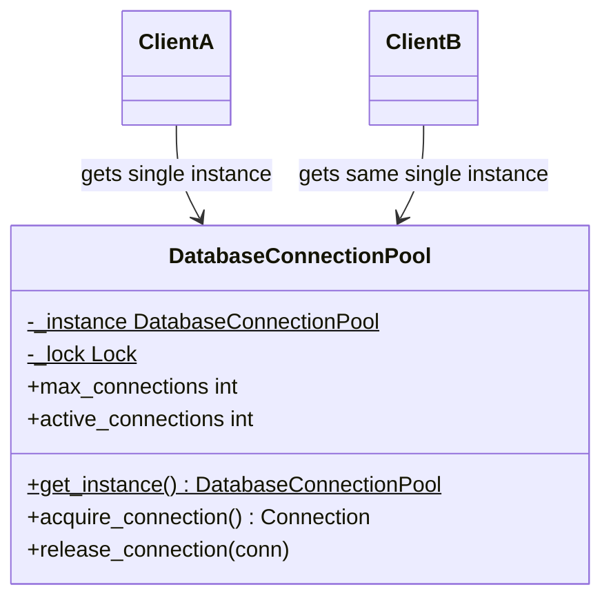
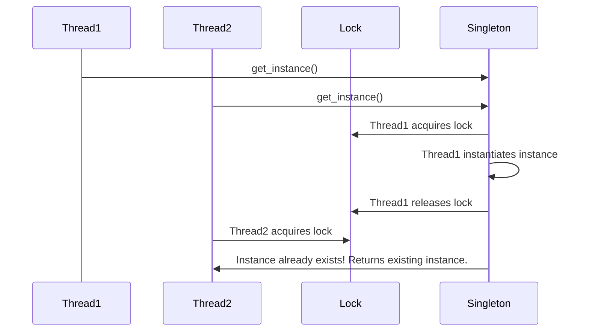

# Singleton Pattern

> [!TIP]
> **Interactive Diagram**: Open [diagram.html](diagram.html) in your browser to explore the interactive animated data flow with theme toggles and SVG/image export.

## Overview
- **Intent**: Ensure a class has only one instance and provide a global point of access to it.
- **Classification**: Creational Pattern.
- **Common Real-World Use Cases**:
  - Database connection pool manager.
  - In-memory cache manager (Redis client wrapper).
  - Centralized application logger / config loader.

## Architecture & Data Flow

### Sequence Flow (Thread-Safe Double-Checked Locking)

## FAANG Interview Gotchas
1. **Multithreading Race Conditions**: Without thread locks, two threads entering `__new__` simultaneously can create two separate instances.
2. **Testing**: Singletons introduce global state, making isolated unit tests tricky if state isn't reset between tests.
3. **Pythonic Idiom**: In Python, modules are already singletons by design (`import config`). When an OOP class is required, use Metaclasses or thread-safe `__new__`.
