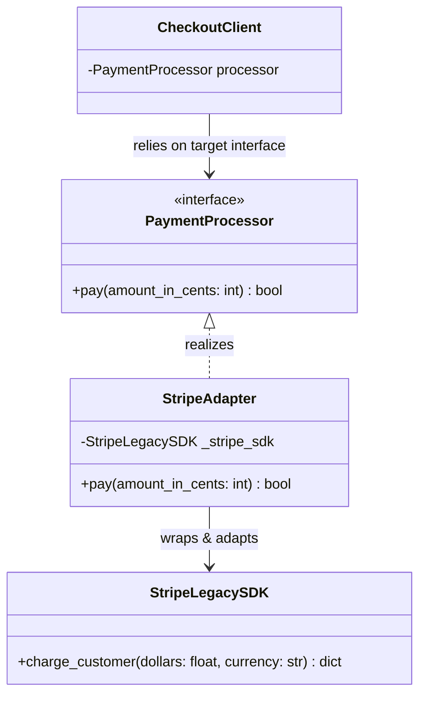

# Adapter Pattern

> [!TIP]
> **Interactive Diagram**: Open [diagram.html](diagram.html) in your browser to explore the interactive animated data flow with theme toggles and SVG/image export.

## Overview
- **Intent**: Convert the interface of a class into another interface clients expect. Adapter lets classes work together that couldn't otherwise because of incompatible interfaces.
- **Classification**: Structural Pattern (Wrapper).
- **Common Real-World Use Cases**:
  - Unifying incompatible 3rd-party payment SDKs (Stripe vs Razorpay vs PayPal).
  - Legacy system migrations (adapting old XML-based APIs to modern JSON REST endpoints).

## Architecture & Data Flow

## FAANG Interview Significance
- Standard question: *"You have an existing order service that calls Stripe. How do you integrate PayPal and Razorpay without rewriting your order processing logic?"*
- Answer: Define a unified `PaymentProcessor` interface and wrap each vendor in its own `Adapter`.
