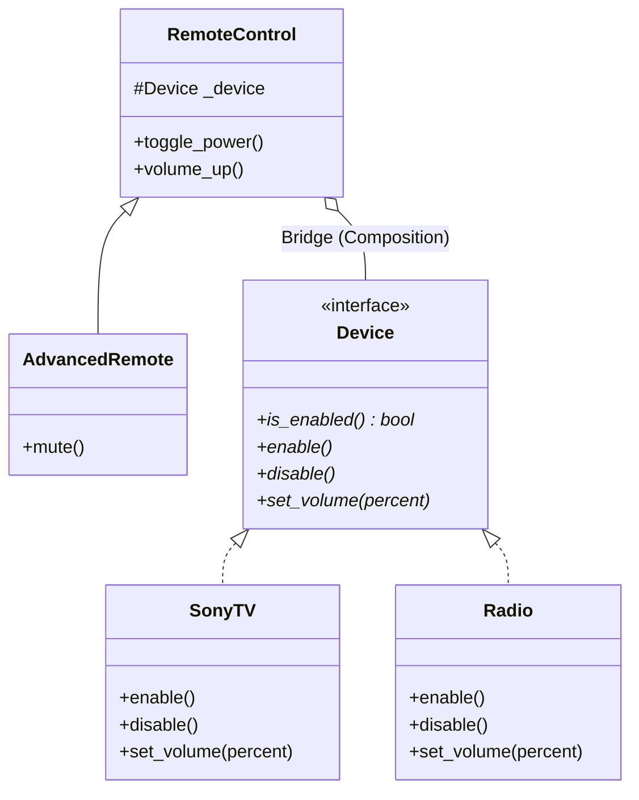

# Bridge Pattern

> [!TIP]
> **Interactive Diagram**: Open [diagram.html](diagram.html) in your browser to explore the interactive animated data flow with theme toggles and SVG/image export.

## Overview
- **Intent**: Decouple an abstraction from its implementation so that the two can vary independently.
- **Classification**: Structural Pattern.
- **Problem It Solves (Class Explosion)**:
  - If you have 2 types of Remote Controls (BasicRemote, AdvancedRemote) and 3 types of Devices (SonyTV, SamsungTV, Radio), naive inheritance creates $2 \times 3 = 6$ subclasses (`BasicSonyRemote`, `AdvancedSonyRemote`, `BasicRadioRemote`, etc.).
  - With Bridge, we maintain two independent class hierarchies linked by composition: **Abstraction** (`RemoteControl`) has a reference to **Implementor** (`Device`).

## Architecture & Data Flow

## FAANG Interview Significance
- Separates cross-platform GUI rendering from OS-specific window managers.
- Separates messaging channels (Email, SMS) from message formats (Promotional, Transactional, Urgent).
