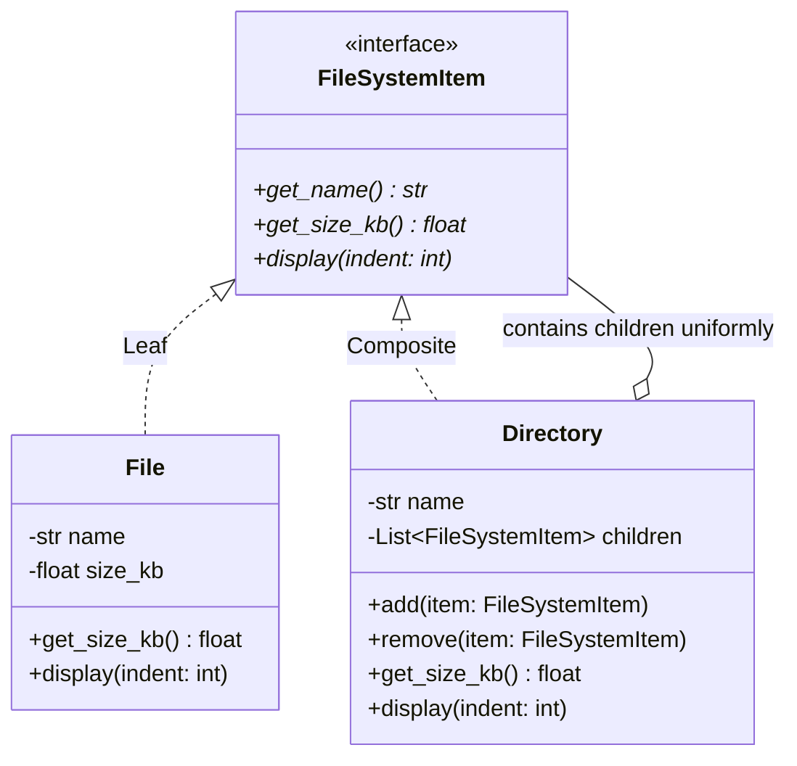

# Composite Pattern

> [!TIP]
> **Interactive Diagram**: Open [diagram.html](diagram.html) in your browser to explore the interactive animated data flow with theme toggles and SVG/image export.

## Overview
- **Intent**: Compose objects into tree structures to represent part-whole hierarchies. Composite lets clients treat individual objects (leaves) and compositions of objects (containers) uniformly.
- **Classification**: Structural Pattern.
- **Problem It Solves**: In a tree structure (like a file system, corporate organization chart, or GUI element hierarchy), you shouldn't have to check `if isinstance(node, Directory): recurse() else: do_leaf()`. Both implement the same interface.

## Architecture & Data Flow

## FAANG Interview Significance
- Essential for tree-based LLD questions: File System (`ls -R` / `du -sh`), Organization Hierarchy (calculating total salary of a department and its sub-departments), and UI DOM trees.
