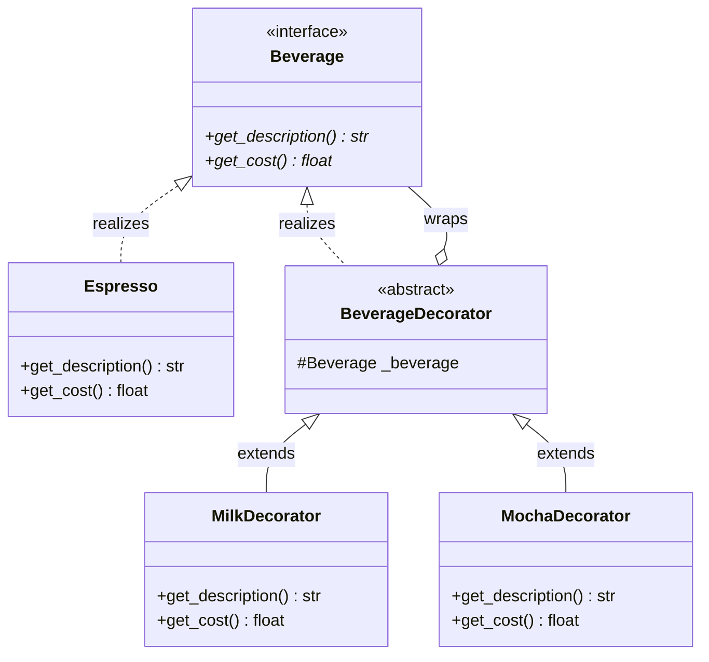

# Decorator Pattern

> [!TIP]
> **Interactive Diagram**: Open [diagram.html](diagram.html) in your browser to explore the interactive animated data flow with theme toggles and SVG/image export.


## Overview
- **Intent**: Attach additional responsibilities or behavior to an object dynamically without modifying its structure or altering the behavior of other instances of the same class.
- **Classification**: Structural Pattern (Wrapper).
- **GoF Object Decorator vs Python Function Decorator**:
  - **GoF Object Decorator**: Wraps an object instance, conforms to the same base interface, and delegates to the inner instance while adding behavior.
  - **Python Function Decorator (`@decorator`)**: Syntactic sugar that wraps a callable function at definition time.

## Architecture & Data Flow



### Wrapping Flow:
```
MochaDecorator ($0.50)
  └─► MilkDecorator ($0.40)
        └─► Espresso ($1.99)
Total = $2.89 | "Espresso, Milk, Mocha"
```

## FAANG Interview Significance
- Eliminates class explosion (avoiding `EspressoWithMilkAndMocha`, `EspressoWithSugar`, etc.).
- Used in I/O streams (Java `BufferedReader(FileReader)` / Python gzip streams), caching decorators, and rate limiters.
