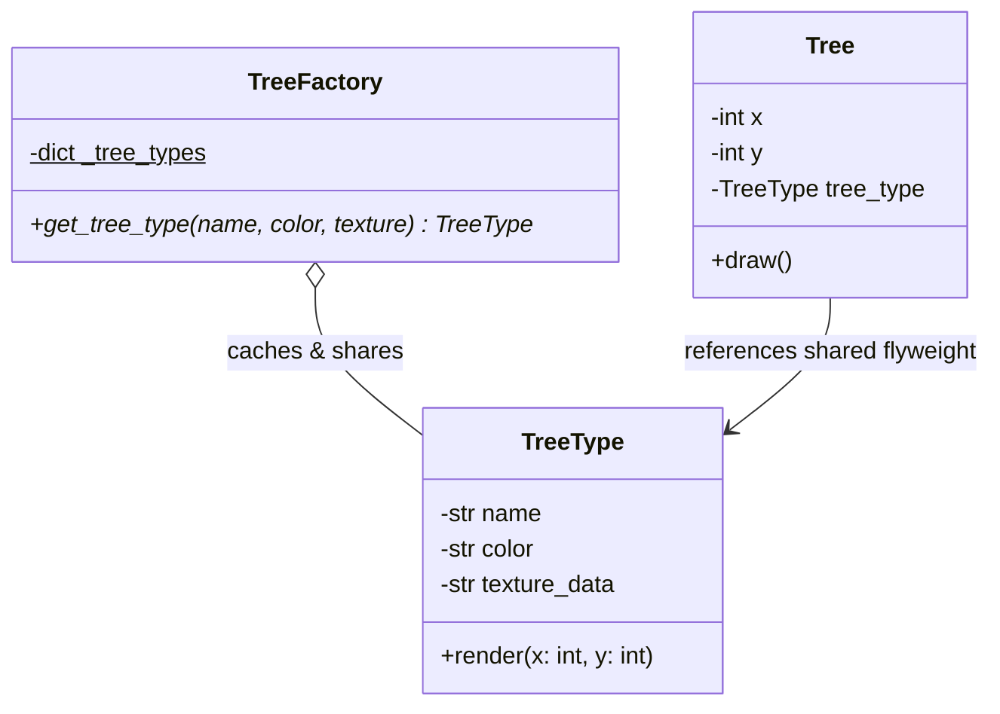

# Flyweight Pattern

> [!TIP]
> **Interactive Diagram**: Open [diagram.html](diagram.html) in your browser to explore the interactive animated data flow with theme toggles and SVG/image export.

## Overview
- **Intent**: Use sharing to support large numbers of fine-grained objects efficiently by minimizing memory consumption.
- **Classification**: Structural Pattern.
- **Intrinsic vs Extrinsic State**:
  - **Intrinsic State**: Constant, immutable data stored inside the flyweight and shared across all instances (e.g. tree sprite, polygon mesh, texture, character glyph).
  - **Extrinsic State**: Context-dependent data passed into flyweight methods from the outside (e.g. x, y coordinates, color tint, scale).

## Architecture & Data Flow

## FAANG Interview Significance
- Memory optimization questions: Rendering massive game maps (1,000,000 trees or bullets), Text editor font formatting (sharing font glyph descriptors across millions of characters).
- Python's internal string interning (`sys.intern`) and small integer caching (-5 to 256) are standard Flyweight implementations!
