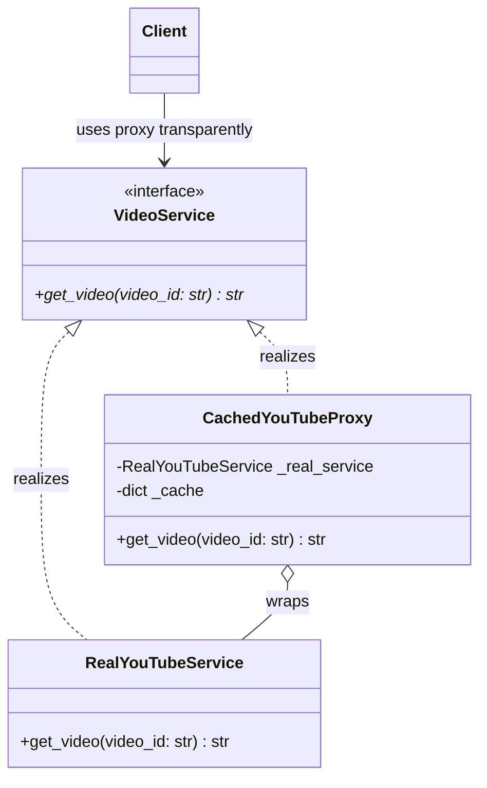

# Proxy Pattern

> [!TIP]
> **Interactive Diagram**: Open [diagram.html](diagram.html) in your browser to explore the interactive animated data flow with theme toggles and SVG/image export.


## Overview
- **Intent**: Provide a surrogate or placeholder for another object to control access to it.
- **Classification**: Structural Pattern (Wrapper).
- **Core Types of Proxies**:
  1. **Virtual Proxy**: Lazy-loads expensive objects only when they are first accessed.
  2. **Protection Proxy**: Controls access rights (e.g. role-based authorization: ADMIN vs USER).
  3. **Caching Proxy**: Stores previous query results in memory (e.g., Redis layer) before hitting a database.
  4. **Remote Proxy**: Represents an object located on a remote server (e.g., gRPC client stub).

## Architecture & Data Flow



### Flow
```
Client -> [CachedYouTubeProxy.get_video("vid_101")]
               |
               +---> Cache Hit? ----> Return cached video data immediately (0ms)
               |
               +---> Cache Miss? ---> Call RealYouTubeService (download over network, 500ms)
                                     └─► Save into Cache & return
```

## FAANG Interview Significance
- Fundamental building block for CDNs (Cloudflare), Redis caching middleware, and database ORM lazy-loading fields.
