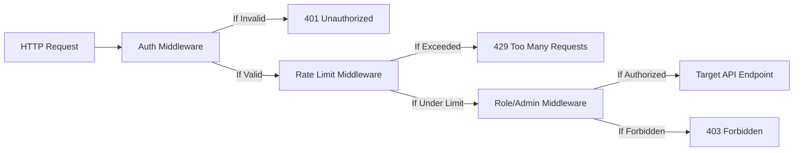

# Chain of Responsibility Pattern

> [!TIP]
> **Interactive Diagram**: Open [diagram.html](diagram.html) in your browser to explore the interactive animated data flow with theme toggles and SVG/image export.

## Overview
- **Intent**: Avoid coupling the sender of a request to its receiver by giving more than one object a chance to handle the request. Chain the receiving objects and pass the request along the chain until an object handles it or the chain ends.
- **Classification**: Behavioral Pattern.
- **Common Real-World Use Cases**:
  - Web framework middleware pipeline (Auth -> RateLimiter -> BodyValidator -> Handler).
  - ATM cash dispenser (₹2000 note handler -> ₹500 note handler -> ₹100 note handler).
  - Multi-level logging (DEBUG -> INFO -> WARNING -> ERROR).

## Architecture & Data Flow

## FAANG Interview Significance
- The foundation of all backend web middleware in FastAPI, Starlette, Flask, and Django.
- ATM cash dispenser is a classic FAANG machine coding prompt.
