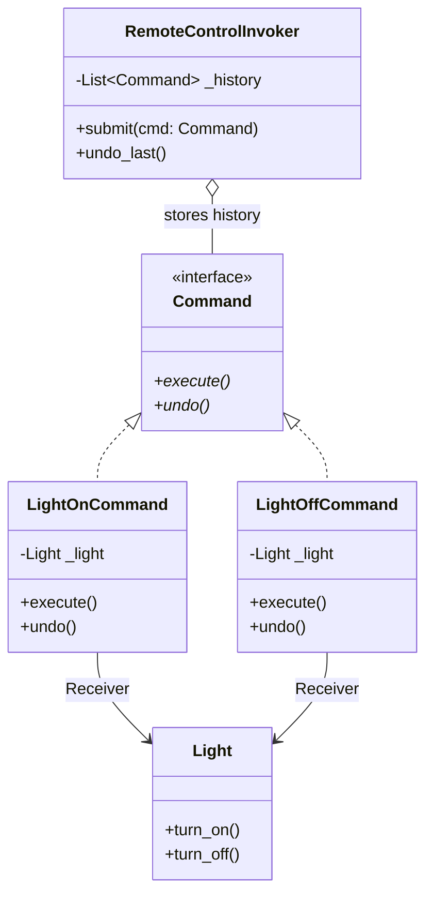

# Command Pattern

> [!TIP]
> **Interactive Diagram**: Open [diagram.html](diagram.html) in your browser to explore the interactive animated data flow with theme toggles and SVG/image export.

## Overview
- **Intent**: Encapsulate a request as an object, thereby letting you parameterize clients with different requests, queue or log requests, and support undoable operations.
- **Classification**: Behavioral Pattern.
- **Key Roles**:
  - **Command Interface**: Declares `execute()` and `undo()`.
  - **Receiver**: The worker that knows how to perform the actual operation (e.g. `Light`, `DatabaseTransaction`).
  - **Invoker**: Triggers the command (e.g. `RemoteControl`, `TaskScheduler`).
  - **Client**: Creates concrete commands and binds them to receivers.

## Architecture & Data Flow

## FAANG Interview Significance
- Essential for Undo/Redo features in text editors, graphic design software, transactional saga orchestrators, and job queue runners (Celery task encapsulation).
