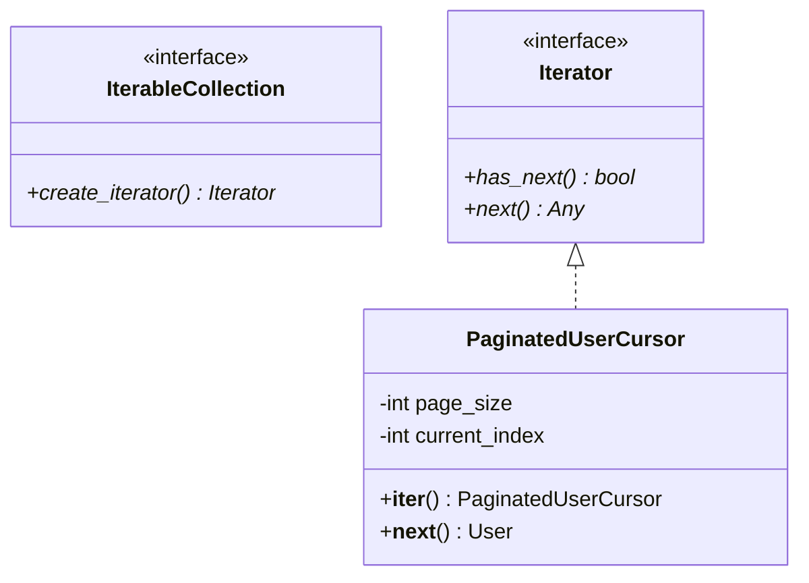

# Iterator Pattern

> [!TIP]
> **Interactive Diagram**: Open [diagram.html](diagram.html) in your browser to explore the interactive animated data flow with theme toggles and SVG/image export.


## Overview
- **Intent**: Provide a way to access the elements of an aggregate object sequentially without exposing its underlying representation (list, tree, hash table, or remote paginated API).
- **Classification**: Behavioral Pattern.
- **Python Native Support**:
  - `__iter__()`: Returns the iterator object itself.
  - `__next__()`: Returns the next element or raises `StopIteration`.
  - Generator expressions and `yield` provide lightweight iterators.

## Architecture & Data Flow



### Data Flow
```
Consumer Loop: for user in paginated_cursor:
                    |
                    v
    [Is buffer empty?]
          |
         YES --> Fetch next page of 50 records from DB / API
          |
          v
    Return next user record from buffer
```

## FAANG Interview Significance
- Memory-efficient streaming of millions of records (preventing Out-Of-Memory errors when querying large SQL/Mongo tables).
- Tree and Graph traversal (BFS/DFS iterators).
