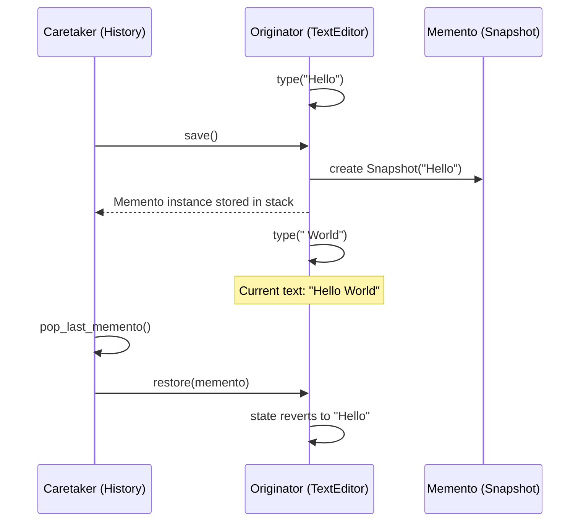

# Memento Pattern

> [!TIP]
> **Interactive Diagram**: Open [diagram.html](diagram.html) in your browser to explore the interactive animated data flow with theme toggles and SVG/image export.

## Overview
- **Intent**: Without violating encapsulation, capture and externalize an object's internal state so that the object can be restored to this state later.
- **Classification**: Behavioral Pattern.
- **Key Roles**:
  - **Originator**: The object whose state needs to be saved/restored (e.g. `TextEditor`).
  - **Memento**: Immutable state snapshot; cannot be altered once created.
  - **Caretaker**: Manages the history/stack of mementos (e.g. `HistoryManager`) without inspecting their inner contents.

## Architecture & Data Flow

## FAANG Interview Significance
- Standard design question: *"Design a Text Editor with Undo/Redo"* or *"Design a Game Save/Checkpoint System"*.
- Strict adherence to Encapsulation: Caretaker cannot tamper with the snapshot data.
