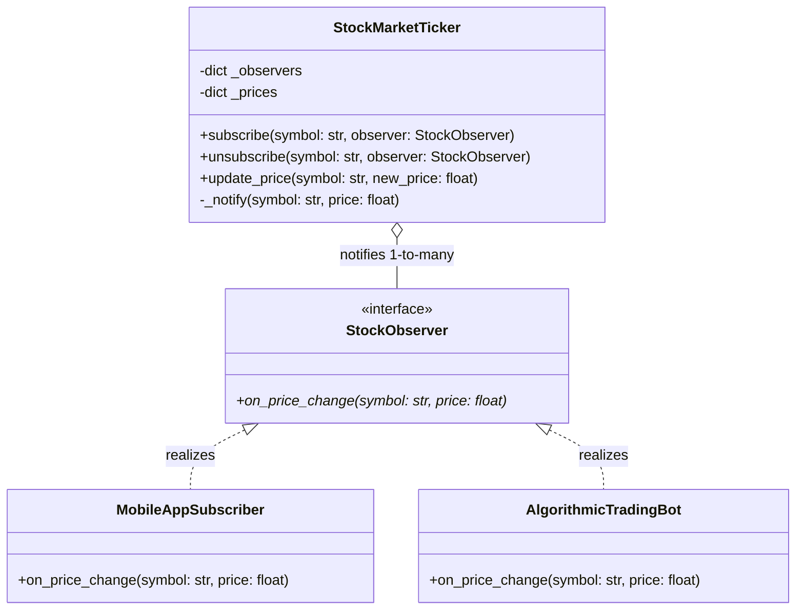

# Observer Pattern

> [!TIP]
> **Interactive Diagram**: Open [diagram.html](diagram.html) in your browser to explore the interactive animated data flow with theme toggles and SVG/image export.

## Overview
- **Intent**: Define a one-to-many dependency between objects so that when one object (Subject / Observable) changes state, all its dependents (Observers / Subscribers) are automatically notified and updated.
- **Classification**: Behavioral Pattern (Pub-Sub).
- **Core Components**:
  - **Subject / Publisher**: Maintains a collection of observers; provides `subscribe()`, `unsubscribe()`, and `notify_observers()`.
  - **Observer / Subscriber**: Defines an `update(state)` interface called when changes occur.

## Architecture & Data Flow

## FAANG Interview Significance
- High-yield pattern in system design: Event-driven notification hubs, WebSocket price tickers, UI event listeners, and In-Memory Pub/Sub messaging.
