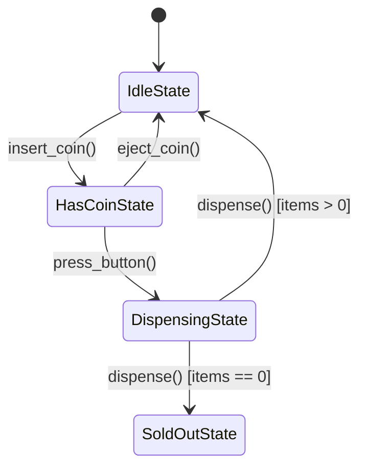
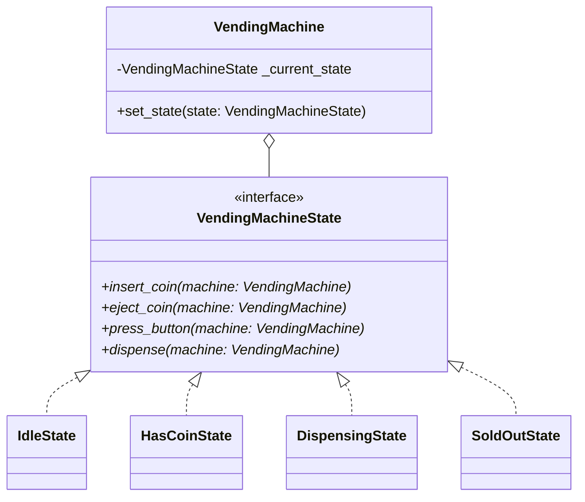

# State Pattern

> [!TIP]
> **Interactive Diagram**: Open [diagram.html](diagram.html) in your browser to explore the interactive animated data flow with theme toggles and SVG/image export.

## Overview
- **Intent**: Allow an object to alter its behavior when its internal state changes. The object will appear to change its class.
- **Classification**: Behavioral Pattern.
- **Problem It Solves**: In complex lifecycles (like a Vending Machine, ATM, or Document Review), using `if state == "DRAFT": ... elif state == "PUBLISHED": ...` in every method creates unmaintainable spaghetti code. The State Pattern extracts each state into an independent class.

## Architecture & Data Flow

### Class Diagram

## FAANG Interview Significance
- The standard pattern for Finite State Machines (FSM): Vending Machine LLD, Elevator Controller, Turnstile, Order Status Lifecycle.
