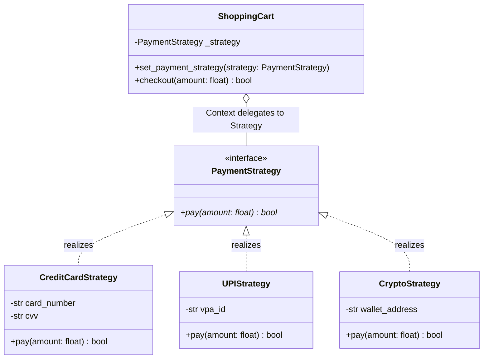

# Strategy Pattern

> [!TIP]
> **Interactive Diagram**: Open [diagram.html](diagram.html) in your browser to explore the interactive animated data flow with theme toggles and SVG/image export.

## Overview
- **Intent**: Define a family of algorithms, encapsulate each one, and make them interchangeable at runtime. Strategy lets the algorithm vary independently from clients that use it.
- **Classification**: Behavioral Pattern.
- **Problem It Solves**: Eliminates rigid conditionals (`if payment_method == 'UPI': ... elif payment_method == 'CARD': ...`) and enables runtime strategy switching.

## Architecture & Data Flow

## FAANG Interview Significance
- The #1 behavioral pattern asked in LLD rounds (Navigation Maps route calculation, Pricing engine, Parking Lot fee calculation, Sorting algorithms).
