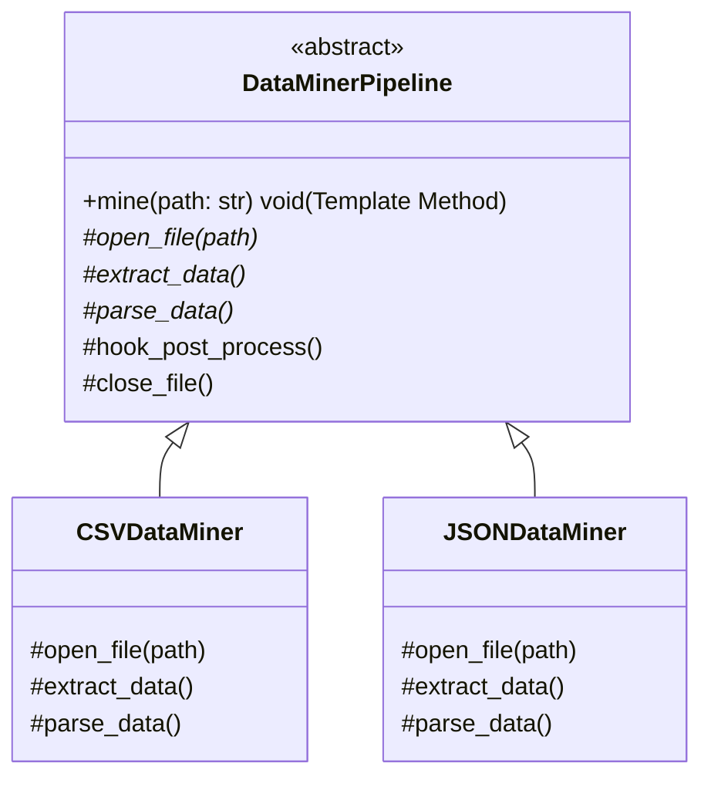

# Template Method Pattern

> [!TIP]
> **Interactive Diagram**: Open [diagram.html](diagram.html) in your browser to explore the interactive animated data flow with theme toggles and SVG/image export.

## Overview
- **Intent**: Define the skeleton of an algorithm in a base class method, deferring some steps to subclasses. Template Method lets subclasses redefine certain steps of an algorithm without changing the overall structure.
- **Classification**: Behavioral Pattern.
- **The Hollywood Principle**: *"Don't call us, we'll call you."* The base class calls the methods of subclasses, not vice-versa.
- **Hooks**: Optional steps with default empty implementations that subclasses can override if desired.

## Architecture & Data Flow

## FAANG Interview Significance
- Essential for web frameworks (e.g. Django's Class-Based Views: `get()`, `post()`, `get_queryset()`, `get_context_data()`).
- Big Data / ETL pipelines (Spark / Beam / Airflow task structures).
