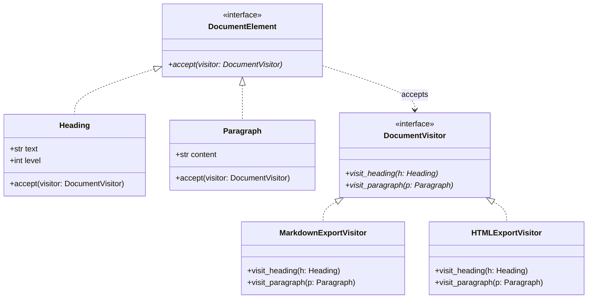

# Visitor Pattern

> [!TIP]
> **Interactive Diagram**: Open [diagram.html](diagram.html) in your browser to explore the interactive animated data flow with theme toggles and SVG/image export.

## Overview
- **Intent**: Represent an operation to be performed on the elements of an object structure. Visitor lets you define a new operation without changing the classes of the elements on which it operates.
- **Classification**: Behavioral Pattern.
- **Double Dispatch**:
  1. The client calls `element.accept(visitor)`.
  2. Inside `accept`, the element calls `visitor.visit_concrete_element(self)`.
  3. The exact operation executed depends on **both** the runtime type of the element and the runtime type of the visitor.

## Architecture & Data Flow

## FAANG Interview Significance
- Compiler AST (Abstract Syntax Tree) traversal (e.g. Python `ast.NodeVisitor`, linting rules, type checking).
- Document rendering and report generation across heterogeneous element hierarchies without polluting data models with export logic.
