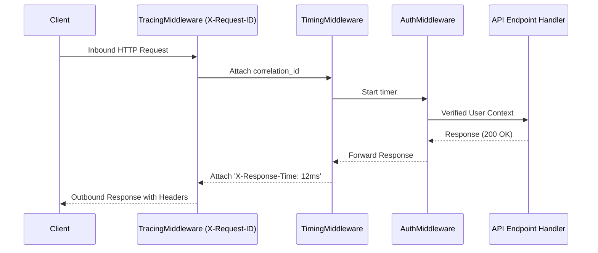

# Middleware Pipeline (Onion Architecture)

> [!TIP]
> **Interactive Diagram**: Open [diagram.html](diagram.html) in your browser to explore the interactive animated data flow with theme toggles and SVG/image export.

## Overview
- **Intent**: Intercept inbound HTTP requests and outbound HTTP responses in an ordered, layered "onion" pipeline.
- **ASGI & WSGI Standard**:
  - **FastAPI / Starlette**: `app.add_middleware(BaseHTTPMiddleware)`.
  - **Django**: `MIDDLEWARE = ['corsheaders...', 'django.contrib.auth...']`.
  - **Flask**: `@app.before_request` and `@app.after_request` hooks.
- **Core Use Cases**:
  - Request execution timing (`Server-Timing` header).
  - Distributed tracing ID propagation (`X-Request-ID`).
  - Centralized exception mapping and formatting.
  - JWT token verification.

## Architecture & Data Flow

## FAANG Interview Significance
- Essential for designing scalable API gateways, service meshes, and web frameworks.
- Cleanly decouples cross-cutting concerns from business route logic.
