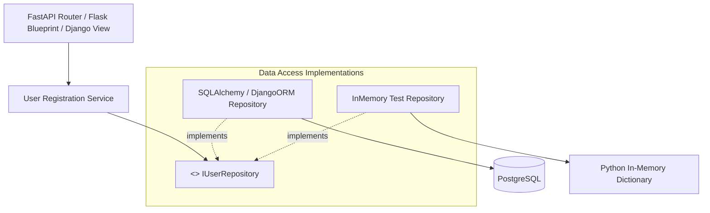

# Repository Pattern

> [!TIP]
> **Interactive Diagram**: Open [diagram.html](diagram.html) in your browser to explore the interactive animated data flow with theme toggles and SVG/image export.


## Overview
- **Intent**: Mediates between the domain and data mapping layers using a collection-like interface for accessing domain objects.
- **Problem It Solves**: In naive web apps (Django views or FastAPI route handlers), SQL/ORM queries (`User.objects.filter(...)` or `db.execute(select(...))`) are scattered everywhere. If the DB schema changes, or if you want to switch from SQLite to PostgreSQL, or write fast in-memory unit tests without database setup, you have to rewrite every route.
- **The Repository Solution**: The service layer only talks to `UserRepository` interface (`get_by_id`, `add`, `list`).

## Architecture & Data Flow



## Framework Mapping
- **FastAPI**:
  ```python
  @router.get("/users/{user_id}")
  def get_user(user_id: str, repo: IUserRepository = Depends(get_user_repo)):
      return repo.get_by_id(user_id)
  ```
- **Flask**: Instantiated inside application factory or injected via Flask-Injector.
- **Django**: Encapsulated inside custom Model Managers or standalone domain repositories.
