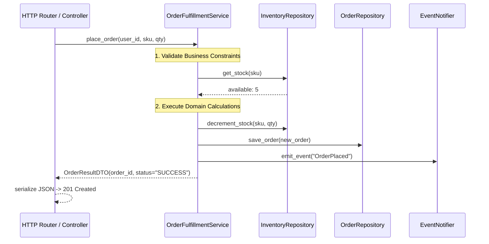

# Service Layer Pattern

> [!TIP]
> **Interactive Diagram**: Open [diagram.html](diagram.html) in your browser to explore the interactive animated data flow with theme toggles and SVG/image export.

## Overview
- **Intent**: Defines an application's boundary with a layer of services that establishes a set of available operations and coordinates the application's response in each operation.
- **"Skinny Controllers, Fat Services"**:
  - **Controllers (FastAPI routers, Flask blueprints, Django views)**: Strictly handle HTTP serialization, query params, headers, and HTTP status codes (200, 400, 404).
  - **Service Layer**: Orchestrates business rules, validation, domain transactions, security checks, and external side-effects (emails, analytics).

## Architecture & Data Flow

## FAANG Interview Significance
- The central pattern for Clean Architecture / Hexagonal Architecture in backend interviews.
- Separates protocol (HTTP, CLI, WebSockets, gRPC) from pure domain logic.
