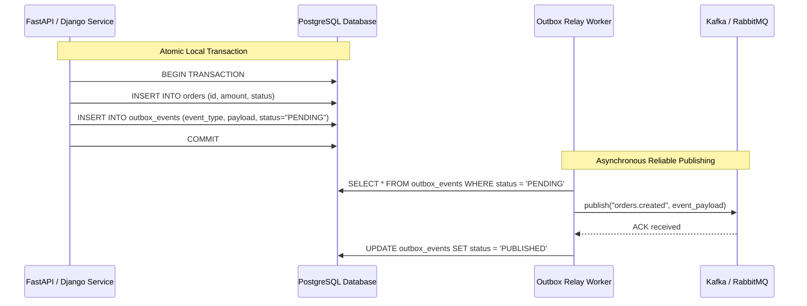

# Transactional Outbox Pattern

> [!TIP]
> **Interactive Diagram**: Open [diagram.html](diagram.html) in your browser to explore the interactive animated data flow with theme toggles and SVG/image export.

## Overview
- **Intent**: Guarantee reliable event publishing and eliminate the **Dual-Write Problem** when updating a database and publishing messages to a message broker (Kafka, RabbitMQ, Celery).
- **The Dual-Write Problem**:
  - Writing to PostgreSQL and publishing to RabbitMQ/Kafka are two independent operations.
  - If the database commit succeeds but the message broker network drops, the event is permanently lost!
  - If the message publishes first but the database rollback triggers, downstream consumers process ghost data!
- **The Outbox Solution**:
  - Write domain changes AND an Outbox event record in the **same local database transaction**.
  - A background worker (Relay / Debezium CDC) reads un-published outbox records and delivers them to the broker with guaranteed at-least-once delivery.

## Architecture & Data Flow

## FAANG Interview Significance
- The #1 question asked in microservice data consistency interviews.
- Avoids fragile two-phase commit (2PC) protocols while ensuring 100% data consistency.
