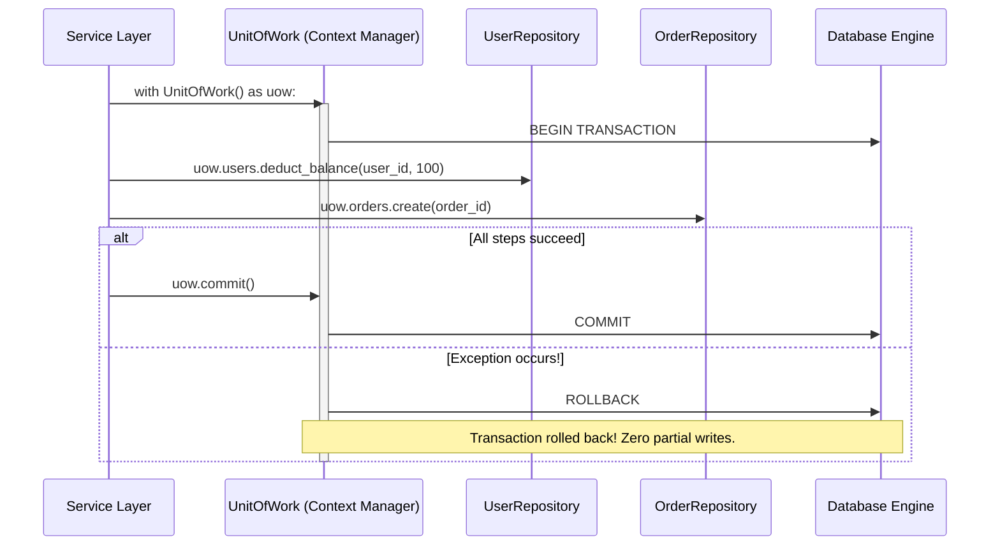

# Unit of Work (UoW) Pattern

> [!TIP]
> **Interactive Diagram**: Open [diagram.html](diagram.html) in your browser to explore the interactive animated data flow with theme toggles and SVG/image export.


## Overview
- **Intent**: Maintains a list of objects affected by a business transaction and coordinates the writing out of changes and the resolution of concurrency problems.
- **Problem It Solves**: In multi-repository operations (e.g. deducting user wallet balance + reserving inventory + creating an order record), calling `repo.save()` individually risks partial database updates if step 3 crashes.
- **Python Context Manager (`with uow:`)**: Encapsulates atomic database transactions (`BEGIN`, `COMMIT`, `ROLLBACK`) across all repositories simultaneously.

## Architecture & Data Flow



## Framework Mapping
- **FastAPI / SQLAlchemy**:
  ```python
  class SqlAlchemyUnitOfWork(AbstractUnitOfWork):
      def __enter__(self):
          self.session = sessionmaker()
          self.orders = SqlOrderRepository(self.session)
          return self
      def commit(self):
          self.session.commit()
      def rollback(self):
          self.session.rollback()
  ```
- **Django**: Mirrors Django's `transaction.atomic()`.
