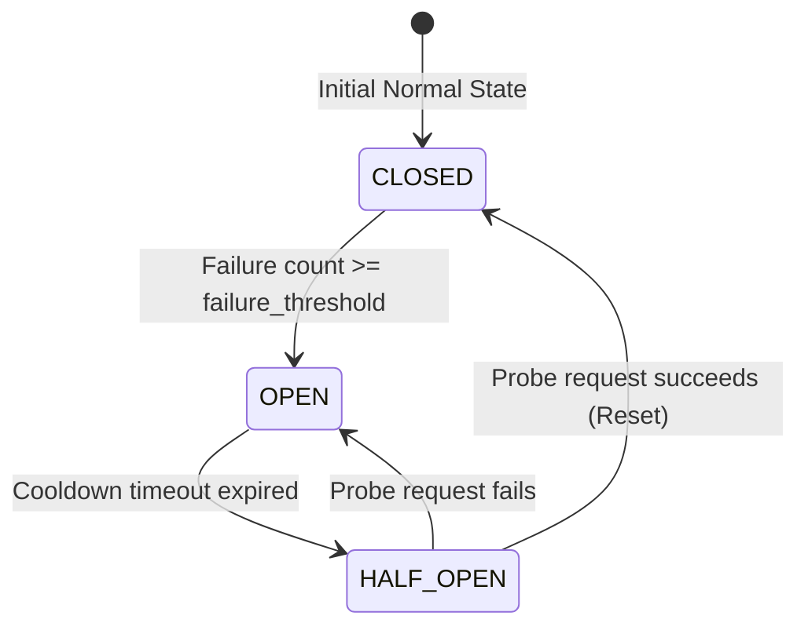

# Circuit Breaker Pattern

> [!TIP]
> **Interactive Diagram**: Open [diagram.html](diagram.html) in your browser to explore the interactive animated data flow with theme toggles and SVG/image export.

## Overview
- **Intent**: Prevent an application from repeatedly trying to execute an operation that's likely to fail, enabling fail-fast behavior and graceful service degradation.
- **Classification**: Resilience & Fault-Tolerance Pattern.
- **The 3 Core States**:
  1. **CLOSED**: Normal operation. Requests pass through. If error count exceeds threshold $N$, transitions to **OPEN**.
  2. **OPEN**: Remote service is down. All requests fail immediately without making network calls. A cooldown timer starts.
  3. **HALF-OPEN**: Cooldown expired. A trial/probe request is sent. If it succeeds, circuit resets to **CLOSED**. If it fails, circuit returns to **OPEN**.

## Architecture & Data Flow

## FAANG Interview Significance
- Essential for microservices resiliency (Netflix Hystrix, Resilience4j, Envoy proxy).
- Protects downstream services from being overwhelmed by retries during outages (prevents thundering herd problems).
