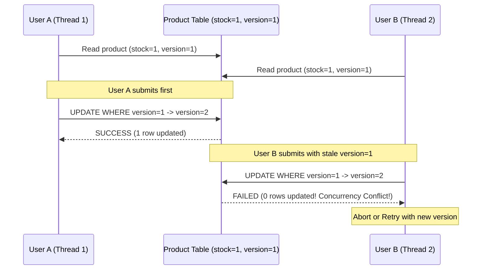

# Concurrency & Locking: Optimistic vs. Pessimistic

> [!TIP]
> **Interactive Diagram**: Open [diagram.html](diagram.html) in your browser to explore the interactive animated data flow with theme toggles and SVG/image export.

## Overview
- **Intent**: Manage concurrent data access and prevent race conditions (e.g. double spending, inventory overselling, or lost updates).
- **Two Dominant Philosophies**:
  1. **Pessimistic Locking**:
     - *"Conflicts will happen often, so lock the row exclusively."*
     - In SQL: `SELECT * FROM seats WHERE id = 42 FOR UPDATE;`
     - In Python: `threading.Lock` / Mutex.
     - Pro: Guarantees 0 write conflicts.
     - Con: Potential deadlocks, high latency under heavy contention.
  2. **Optimistic Locking**:
     - *"Conflicts are rare, so don't lock; check for conflicts at write time using a version number."*
     - In SQL: `UPDATE products SET stock = stock - 1, version = version + 1 WHERE id = 10 AND version = 5;`
     - If rows updated == 0, another transaction won the race; retry or abort.
     - Pro: High read throughput, zero database locks.
     - Con: High retry overhead during flash sales.

## Architecture & Data Flow

## FAANG Interview Significance
- Essential for: Concert ticket booking (BookMyShow / Ticketmaster), Flash Sale inventory (Amazon Big Billion Days), and Banking transfers.
