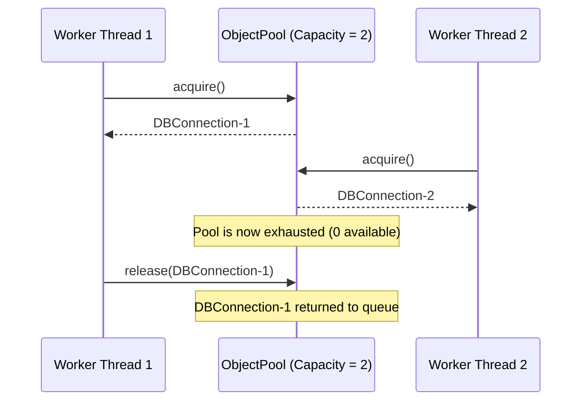

# Object Pool Pattern

> [!TIP]
> **Interactive Diagram**: Open [diagram.html](diagram.html) in your browser to explore the interactive animated data flow with theme toggles and SVG/image export.

## Overview
- **Intent**: Manage the caching and reuse of expensive-to-create objects (such as database socket connections, thread workers, or socket handles) rather than repeatedly creating and destroying them.
- **Classification**: Creational & Concurrency Pattern.
- **Key Mechanism**:
  - A thread-safe queue holding available resources.
  - Client calls `acquire()` (blocks or raises timeout if exhausted).
  - Client returns resource with `release()` (or via a Python context manager).

## Architecture & Data Flow

## FAANG Interview Significance
- How SQLAlchemy Connection Pooling (`QueuePool`), HikariCP (Java), and Gunicorn worker pools function under high load.
- Prevents database crashing from 50,000 simultaneous TCP handshakes.
