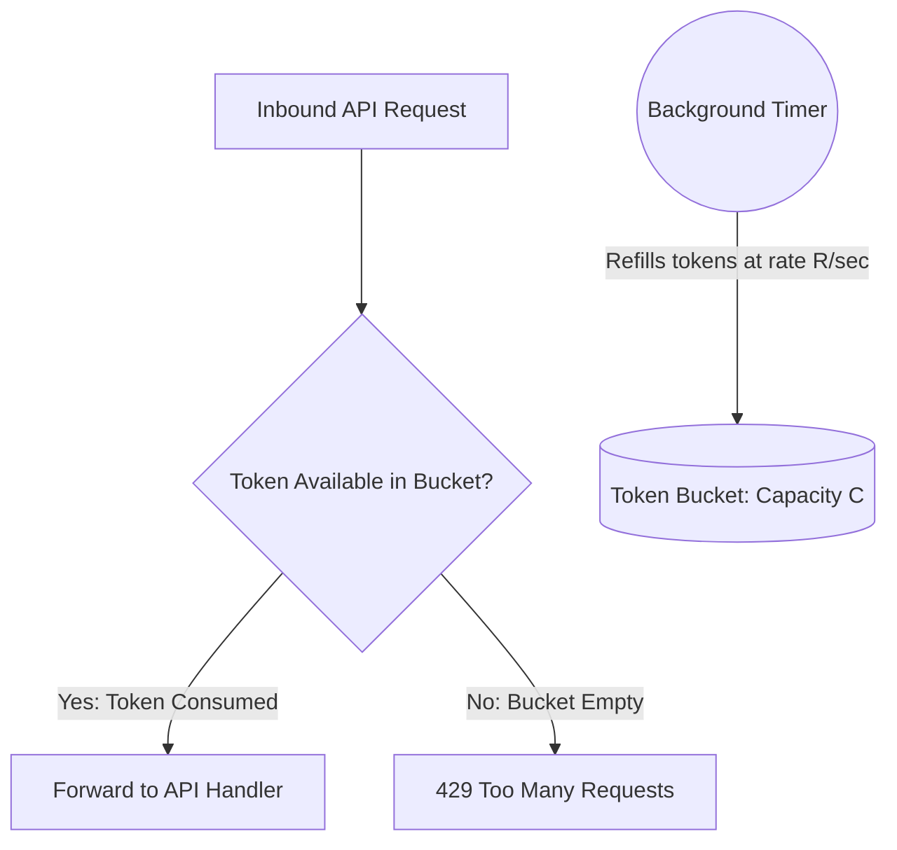

# Rate Limiter Pattern

> [!TIP]
> **Interactive Diagram**: Open [diagram.html](diagram.html) in your browser to explore the interactive animated data flow with theme toggles and SVG/image export.

## Overview
- **Intent**: Control the rate of requests sent or received by a network interface or service to prevent resource starvation, denial of service (DoS), and cascade failures.
- **Classification**: Resilience & Concurrency Pattern.
- **Core Algorithms**:
  1. **Token Bucket**: Tokens are continuously added at a fixed refill rate up to a max capacity. Each request consumes 1 token. Supports traffic bursts up to capacity.
  2. **Sliding Window Log**: Stores timestamps of every request in a sorted set (like Redis ZSET). Calculates request count within the last window interval (e.g. 60s). Extremely accurate, no boundary bursts.
  3. **Leaky Bucket**: Requests enter a queue and are processed at a strictly constant rate.

## Architecture & Data Flow

## FAANG Interview Significance
- One of the top 3 most requested interview questions across both LLD and HLD rounds.
- Evaluates concurrency, thread safety (`threading.Lock`), time arithmetic, and resilience.
