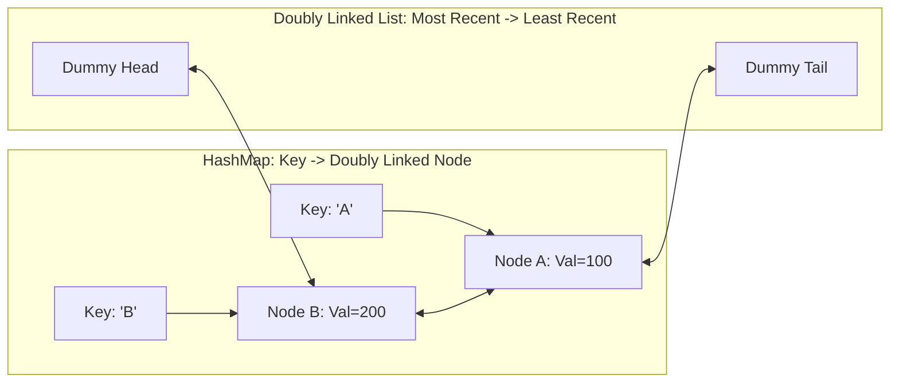

# LRU Cache (Least Recently Used Cache)

> [!TIP]
> **Interactive Diagram**: Open [diagram.html](diagram.html) in your browser to explore the interactive animated data flow with theme toggles and SVG/image export.

## Overview
- **Problem**: Design and implement a data structure for a Least Recently Used (LRU) cache that supports both `get(key)` and `put(key, value)` operations in **$O(1)$ average time complexity**.
- **Data Structure Composition**:
  - **Hash Map (`Dict[Key, Node]`)**: Provides $O(1)$ key lookup.
  - **Doubly Linked List (`head <-> node <-> tail`)**: Maintains usage ordering with $O(1)$ node insertion at the head (most recently used) and $O(1)$ node removal from the tail (least recently used).

## Architecture & Data Flow

### Operation Lifecycles:
1. **`get(key)`**:
   - Lookup node in Hash Map.
   - If found, remove node from current list position and re-insert right after `Head` (marked MRU).
   - Return node value.
2. **`put(key, value)`**:
   - If key exists: update value, move to `Head`.
   - If key does not exist: create node, insert at `Head`, add to Hash Map.
   - If `len > capacity`: remove node before `Tail` (LRU) from list and delete from Hash Map.

## FAANG Interview Significance
- The single most common coding & LLD question asked at Google, Meta, Amazon, and Microsoft.
