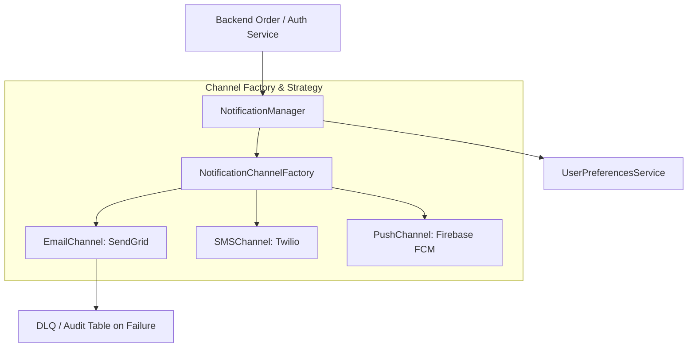

# Multi-Channel Notification Service (Machine Coding)

> [!TIP]
> **Interactive Diagram**: Open [diagram.html](diagram.html) in your browser to explore the interactive animated data flow with theme toggles and SVG/image export.

## Overview
- **Problem**: Design and implement a scalable, fault-tolerant Multi-Channel Notification Service.
- **Requirements**:
  1. Support multiple delivery channels: Email (SendGrid/SES), SMS (Twilio), Mobile Push (FCM).
  2. Channel-specific payload validation and template rendering.
  3. Priority-based queueing (`CRITICAL` e.g. OTPs vs `MARKETING` e.g. Newsletter).
  4. User preferences management (e.g. User disabled SMS notifications).
  5. Fallback & Retry mechanism if primary channel fails.

## Architecture & Data Flow

## Applied Design Patterns
- **Factory Method**: Instantiates concrete channel handlers based on channel type.
- **Strategy Pattern**: Delivery and retry policies (Exponential Backoff vs Direct Fail).
- **Observer Pattern**: Emits audit and analytics delivery events.
- **Facade Pattern**: Exposes a clean, single `notify(user_id, template, data)` API.
